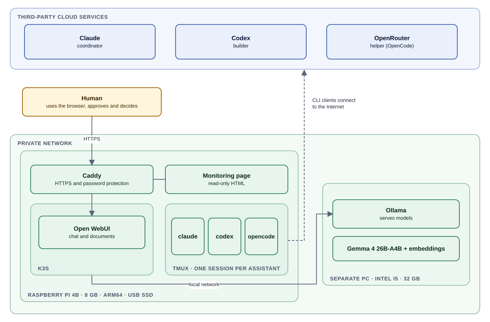
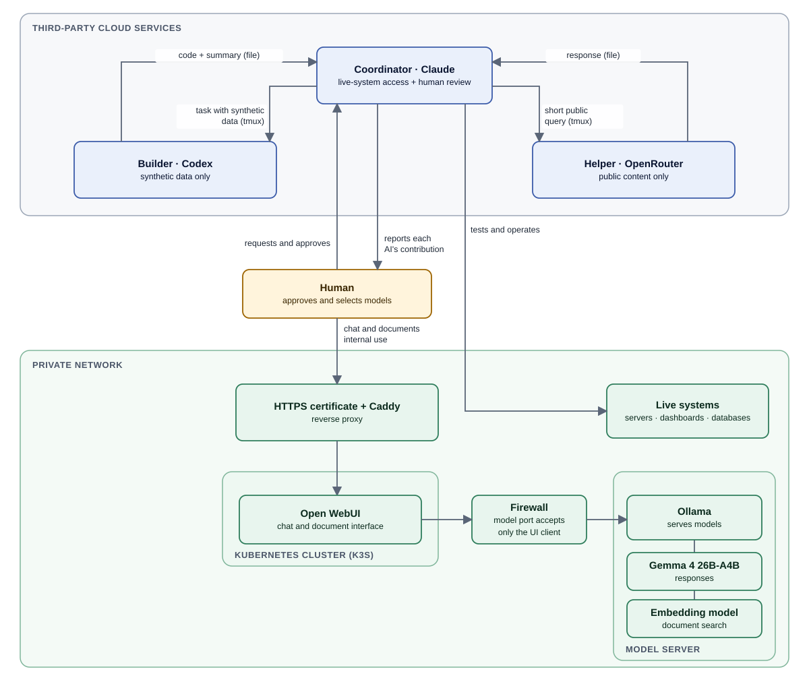

# AI Split Raspberry Pi

> *Modular workload distribution system for Raspberry Pi.*

**Three AI assistants and a self-hosted model working together on self-hosted infrastructure, with a person who makes the calls.**
A delegation scheme between Claude, Codex and OpenRouter/OpenCode: who does what, how tasks are requested,
what is never delegated and what happened when something failed.

[Versión en español](README.es.md) · Author: Mariano Araujo · MIT License

## In one minute

1. **Problem:** a single assistant runs out of quota and mixes tasks with different risk; with several and no rules,
   sensitive data ends up in the wrong place.
2. **Decision:** split the work by **data risk**, not by difficulty. Sensitive work stays with whoever has the real access
   and human review; code is delegated with fictional data; short public questions go to an economical model.
3. **What I implemented:** the role and rule design, an example router with tests, a delegation script over
   `tmux` with tests, and the setup of a self-hosted model. The AI assistants wrote and tested a good part of the code.
4. **How to verify it in a minute:**
   ```bash
   python3 -m unittest discover -s tests -v   # router, monitor and bilingual docs tests
   bash tests/test_delegate.sh                # 5 script cases, with a simulated tmux
   ```

## Hardware: everything on one Raspberry Pi 4B with 8 GB

The goal is for **everything to fit on a single Raspberry Pi 4B with 8 GB**: the three assistants' consoles (in `tmux`),
the HTTPS publisher (Caddy), Open WebUI on k3s and a monitoring web page that refreshes the consoles. Only the
self-hosted model runs separately, on an Intel i5 machine with 32 GB. Details and memory budget (estimated) in
[`docs/hardware.md`](docs/hardware.md) (Spanish); [installation guide for third parties](docs/install.en.md).



## The participants

| Participant | Role | Receives (by rule) | Never receives (by rule) |
|---|---|---|---|
| **Coordinator** (Claude) | Coordinates, reviews, tests and publishes; works with real access | Everything sensitive or unclassified | — |
| **Builder** (Codex) | Writes code and tests | Prompts with **fictional** data | Credentials, real data |
| **Auxiliary** (OpenRouter/OpenCode, economical model) | Short questions and second opinions | Public content only | Any data that identifies someone |
| **Self-hosted model** (Ollama + Open WebUI) | Short tasks on internal documents, without sending anything out | Documents without sensitive data | — |

A person approves everything that goes out and decides model changes.



*High-resolution version: [`01-diagrama-general.png`](docs/assets/01-diagrama-general.en.png). The guides under `docs/` still use the Spanish diagrams.*

## What it includes

- [`src/route.py`](src/route.py): example router and [its tests](tests/test_route.py). It **recommends** a destination; it does not detect secrets or ask for approvals.
- [`src/delegate.sh`](src/delegate.sh) and [its tests](tests/test_delegate.sh): send a request to an assistant in a `tmux` session and wait for its answer in a file.
- [`src/preflight.sh`](src/preflight.sh) and [its tests](tests/test_preflight.sh): checks the prerequisites before installing (it changes nothing on the system).
- [`src/consoles.sh`](src/consoles.sh) and [`src/monitor.py`](src/monitor.py): launch the assistants in `tmux` and watch them from the browser on a read-only page that refreshes itself ([tests](tests/test_monitor.py)).
- [`examples/`](examples/): general configuration ready to copy (variables, Caddy with HTTPS, Open WebUI on k3s, systemd services).
- [`docs/`](docs/) in English: [installation guide](docs/install.en.md) and [how to try it](docs/getting-started.en.md). In Spanish: [hardware](docs/hardware.md), [monitoring](docs/monitoring.md), [daily operations](docs/operations.md), [architecture](docs/architecture.md), [models](docs/models.md), [self-hosted model](docs/local-model.md), [execution example](docs/execution-example.md), [decisions](docs/decisions.md) and [limits](docs/limitations.md).

## What this repository guarantees and what it does not

- **Yes:** the split rules are written down, the example router follows them in the tested cases and the
  delegation script handles the test cases (busy, permission prompt, timeout, complete answer).
- **No:** that no sensitive data ever leaves. The coordinator and the other assistants are third-party services; the
  separation depends on **procedures** (what goes into each prompt, human review), not on code. Only the
  self-hosted model processes data without sending it outside the network.

## Models

The model is matched to the use: one optimized for everyday tasks and a stronger one only when the complexity or the
required skill demands it, for Claude, Codex and OpenRouter. On OpenRouter, free and paid models were compared, the
cost per query was calculated and the cheapest and fastest of those tested was chosen for short questions.
Details and method in [`docs/models.md`](docs/models.md) (Spanish).

## Self-hosted model

It runs on a machine with an Intel i5 CPU and 32 GB of RAM, no GPU. The speed of five models was measured and
Gemma 4 26B-A4B was chosen (7 to 11 tokens per second). It is meant for short tasks on internal documents; it is not
for demanding reasoning. Measurements, uses and limits in [`docs/local-model.md`](docs/local-model.md) (Spanish).

## Skills

Each tool's official skills are preferred. A custom skill is built only for a specific use and is
documented (what it does and why an official one was not enough). Installing third-party skills is avoided; it is only
done after a thorough review.

## My contribution and the AI's

- **Mine:** the design of roles and data rules, what gets delegated, the approval of everything that is published, the choice of
  models and the usage limits.
- **The AI's:** writing and testing a good part of the code, researching and proposing alternatives. Every task leaves a record.

## Limits

This is a technical case with a small sample. It does not include the complete system, it does not measure productivity and it does not prove that the
scheme works for other teams. Details in [`docs/limitations.md`](docs/limitations.md) (Spanish).
